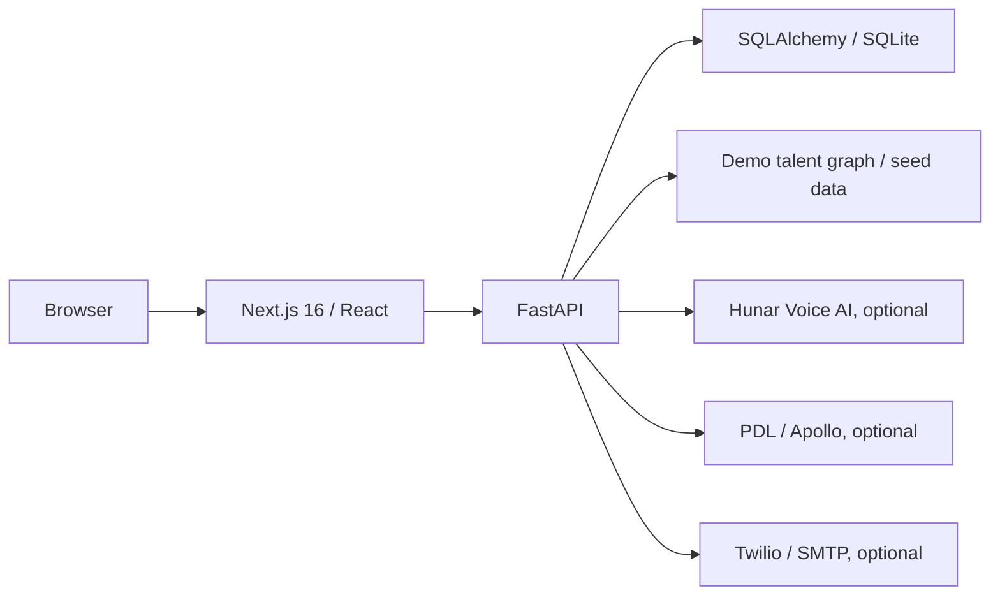

# Hirynex

Hirynex is a hiring and workforce automation prototype that brings jobs, candidates, voice-screening integrations, outreach, and attendance views into one web app. It demonstrates the workflow from a job description to candidate review and site attendance while keeping live external actions explicitly configuration dependent.

## Implemented features

- FastAPI routes for jobs, candidates, agents, calls, people search, outreach, attendance, dashboards, and Hunar callbacks.
- Next.js pages for hiring, search, dashboard, attendance, and design notes.
- SQLite persistence through SQLAlchemy; startup seeds two example jobs and 100 demonstration sites with 1,000 synthetic workers.
- Job-description parsing and a demo talent graph when PDL/Apollo search is unavailable.
- Hunar Voice AI API adapter for agent creation and candidate calls when a valid key is supplied.
- Optional Twilio WhatsApp and SMTP delivery. Without credentials, messaging is simulated. Demo candidates are prevented from receiving live voice calls or messages.

The app does **not** autonomously recruit candidates. Real calls, people-search data, and delivery depend on external accounts, consent, and valid credentials. No live calls, emails, or messages are needed to try local screens.

## Architecture and stack



The frontend uses TypeScript and Tailwind CSS 4. The backend uses Python 3.12+, FastAPI, SQLAlchemy, Pydantic, and HTTPX. API response field names and existing database filenames are retained for compatibility.

## Local setup

Copy `.env.example` to `.env` in the repository root. It includes placeholders for `HUNAR_API_KEY`, `HUNAR_API_BASE`, `PUBLIC_BASE_URL`, `PDL_API_KEY`, `APOLLO_API_KEY`, Twilio/SMTP settings, `FRONTEND_ORIGIN`, and `DATABASE_URL`. Do not put live secrets in Git. Leave external keys empty for a local demonstration.

```bash
cd backend
python3 -m venv .venv
. .venv/bin/activate
pip install -r requirements.txt
uvicorn app.main:app --host 127.0.0.1 --port 8000
```

In a second terminal:

```bash
cd frontend
npm ci
cp .env.example .env.local
npm run dev
```

Open `http://localhost:3000`; API docs are at `http://127.0.0.1:8000/docs`. `NEXT_PUBLIC_API_URL` should point to the backend. The backend loads the root `.env` when run from `backend/`, and creates/seeds its local database at startup when empty.

## Validation and deployment

```bash
cd backend && python -m compileall -q app
cd frontend && npx tsc --noEmit && npm run lint && npm run build
```

There is no checked-in automated backend test suite. `backend/railway.json` and root `vercel.json` provide deployment configuration examples. Set the exact frontend HTTPS origin in `FRONTEND_ORIGIN`; CORS allows that origin and local development origins. Set `PUBLIC_BASE_URL` to a publicly reachable HTTPS backend for Hunar callbacks. Review the host's service routing and persistent database choice before deployment: local SQLite on ephemeral hosting loses state.

The current API and Hunar webhook have no application-level authentication or webhook signature verification. Do not expose them for real candidate operations until authorization, consent, rate controls, and webhook verification are implemented. Avoid triggering paid APIs with demo records.

## Attribution and licensing

The maintainer confirmed publication rights for this application's source code. This local snapshot has no source Git history or root license file; no exclusive license is asserted over third-party materials. Review any future third-party assets before adding them.

Repository: [Gaurav598/Hirenex-AI-Hiring-Workforce-Automation](https://github.com/Gaurav598/Hirenex-AI-Hiring-Workforce-Automation)
